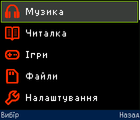
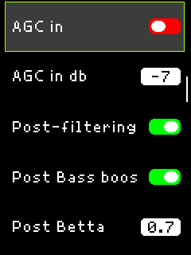
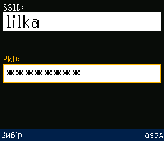
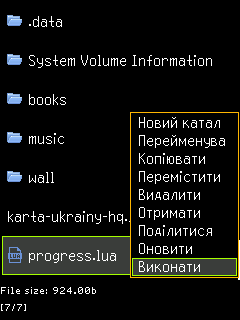
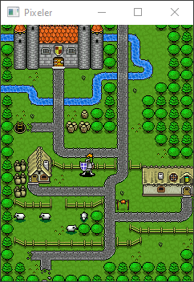
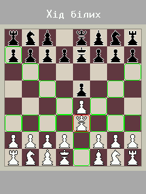

<div align="center">

# 🎨 Pixeler

**Lightweight C++ GUI, Game & Firmware Framework for ESP32 / ESP32-S3 / ESP32-P4**  
*Швидкий фреймворк для розробки прошивок, графічних інтерфейсів та ігор під мікроконтролери ESP32*

[](LICENSE)
[](library.json)
[](https://github.com/Kolodieiev/pixeler)
[](https://github.com/Kolodieiev/pixeler)
[](https://github.com/Kolodieiev/pixeler4pc)

[**🇬🇧 English**](#-english) | [**🇺🇦 Українська**](#-українська) | [**📚 Documentation / Документація**](docs/) | [**💻 PC Simulator (`pixeler4pc`)**](https://github.com/Kolodieiev/pixeler4pc)

---

### 📸 Showcase / Приклади інтерфейсів та застосунків

| Animated Menu UI | System Settings | Text Input & Virtual Keyboard |
| :---: | :---: | :---: |
|  |  |  |
| **Lua Scripting Context** | **2D RPG Game Engine Demo** | **Chess Game on ESP32-S3** |
|  |  |  |

</div>

---

## 🇬🇧 English

**Pixeler** is a modular C++ graphics, UI, and firmware framework designed for **ESP32**, **ESP32-S3**, and **ESP32-P4** microcontrollers. Instead of writing low-level boilerplate code for display rendering, screen transitions, file systems, and hardware inputs from scratch, Pixeler provides a ready-to-use application architecture inspired by Android's `Activity` lifecycle.

### ✨ Key Features

* **📱 Context-Based Architecture:** Manage applications, games, and screens using isolated Contexts (`IContext`) with automatic memory allocation and cleanup on transitions.
* **⚡ Rich UI Widgets & 2D Graphics:** Built on top of `Arduino_GFX`, offering ready-made UI widgets (menus, settings lists, textboxes with on-screen keyboards, dialogs) and smooth sprite rendering for 2D games (Chess, RPGs, etc.).
* **🌙 Lua Scripting Support:** Run dynamic user scripts and contexts powered by **Lua** without reflashing the microcontroller.
* **🖥️ Rapid Prototyping on PC ([pixeler4pc](https://github.com/Kolodieiev/pixeler4pc)):** Design, debug, and test your ESP32 graphical interfaces directly on your computer.
* **🎮 Unified Hardware Abstractions:** Out-of-the-box support for mechanical buttons, touchscreens, keyboards, I2C GPIO expanders, SD cards, and audio playback.
* **🤖 AI-Assisted Development Ready:** Includes [`AGENTS.md`](AGENTS.md) and structured documentation in [`docs/`](docs/) so AI coding assistants can generate valid Pixeler code immediately.

### 🛠️ Supported Hardware & Ecosystem

| Target / Project | Description | Link |
| :--- | :--- | :--- |
| **ESP32 / ESP32-S3 / ESP32-P4** | Core microcontroller families supported by Pixeler | [`src/`](src/) |
| **Perfect-Devboard** | Reference firmware & apps for Universal ESP32-S3 + CH32 board | [`examples/ESP32S3/Perfect-Devboard`](examples/ESP32S3/Perfect-Devboard) |
| **Lilka v2** | Alternative firmware built on Pixeler | [`examples/ESP32S3/Lilka_v2`](examples/ESP32S3/Lilka_v2) |
| **pixeler4pc** | Ported GUI engine for fast desktop UI development | [`Kolodieiev/pixeler4pc`](https://github.com/Kolodieiev/pixeler4pc) |

### 🚀 Quick Start (Pioarduino)

Add Pixeler to your `platformio.ini` or explore the ready-to-build firmware projects in [`examples/`](examples/):

```ini
lib_deps =
    [https://github.com/Kolodieiev/pixeler.git](https://github.com/Kolodieiev/pixeler.git)
```

Full setup instructions, driver configuration, and widget guides are available in the [**`docs/`**](docs/) directory.

---

## 🇺🇦 Українська

**Pixeler** — це модульний C++ фреймворк для швидкої розробки власних прошивок, графічних інтерфейсів (GUI) та 2D-ігор під мікроконтролери **ESP32**, **ESP32-S3** та **ESP32-P4**.

> **Готова архітектура замість рутини:** Pixeler бере на себе рендеринг графіки (`Arduino_GFX`), життєвий цикл екранів (за принципом Android `Activity`), віртуальну клавіатуру, роботу з SD-картою, звуком та вводом. Ви пишете лише логіку своїх застосунків або ігор.

### ✨ Основні можливості

* **📱 Система Контекстів (Contexts):** Кожен екран, гра або застосунок є ізольованим контекстом. Пам'ять виділяється лише під активний контекст і автоматично звільняється при перемиканні.
* **🧩 Віджети та ігрова графіка:** Готові компоненти інтерфейсу (анімовані меню, налаштування, текстові поля з клавіатурою, списки) та швидка робота зі спрайтами для 2D-ігор (шахи, RPG тощо).
* **🌙 Підтримка Lua:** Можливість виконання користувацьких Lua-скриптів та створення динамічних контекстів без перепрошивки плати.
* **💻 Симулятор для ПК ([pixeler4pc](https://github.com/Kolodieiev/pixeler4pc)):** Портована GUI-частина дозволяє верстати та тестувати інтерфейси прямо на комп'ютері за секунди.
* **🎛️ Робота з периферією:** Підтримка дисплеїв, тачскрінів, кнопок, I2C-експандерів, аудіо та SD-карт.
* **🤖 Підтримка AI-асистентів:** Файл [`AGENTS.md`](AGENTS.md) та документація в [`docs/`](docs/) дозволяють ШІ-агентам (Cursor, Copilot, Windsurf) миттєво генерувати валідний код під архітектуру Pixeler.

### 📂 З чого почати

1. **Перегляньте готові прошивки у [`examples/`](examples/):**
   * [**Perfect-Devboard**](examples/ESP32S3/Perfect-Devboard) — повноцінна прошивка з меню, налаштуваннями, Lua-контекстом та іграми для плати [perfect_devboard](https://github.com/Kolodieiev/perfect_devboard).
   * [**Lilka v2**](examples/ESP32S3/Lilka_v2) — порт прошивки під українську ретро-консоль Lilka v2.
2. **Ознайомтесь із документацією в [`docs/`](docs/):** покрокові інструкції з налаштування драйверів, створення власних контекстів та використання віджетів.
3. **Спробуйте розробку на ПК:** завантажте [**pixeler4pc**](https://github.com/Kolodieiev/pixeler4pc) для швидкого прототипування UI без заліза.

---

## ⭐️ Підтримка проєкту / Support

If **Pixeler** is useful for your ESP32 projects, please give this repository a **⭐️ Star**!  
Якщо проєкт став вам у пригоді — підтримайте репозиторій **⭐️ зірочкою**!

## 📄 License / Ліцензія

Licensed under the [**Apache License 2.0**](LICENSE).
